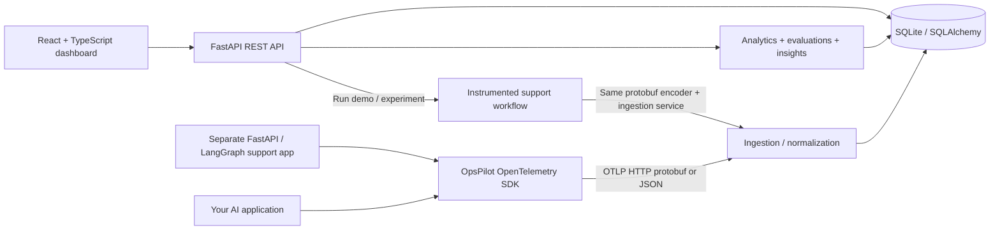

# OpsPilot

**AI Observability & Performance Intelligence Platform**

Monitor, understand, evaluate, and optimize every AI execution.

OpsPilot follows a request through agents, model calls, retrieval, and tools,
then turns that telemetry into inspectable traces, measured analytics, quality
evaluations, and evidence-backed optimization recommendations. It is a working
local application with a FastAPI backend, SQLite storage, a React dashboard,
and a separately runnable LangGraph support application.

[](https://dashboard.render.com/blueprint/new?repo=https%3A%2F%2Fgithub.com%2FDEEPUOG21%2FOPS_PiLOT)

For a public portfolio demo, the repository includes a single-service hosting
configuration with mock-only execution. See [showcase deployment](deploy/README.md).

## Why it exists

An incorrect answer, expensive prompt, or slow agent is difficult to debug from
application logs alone. OpsPilot connects the execution tree to captured inputs,
outputs, timing, usage, prices, evaluations, and experiments. Recommendations
include evidence and a next action; absent evidence stays unavailable.

## Features

| Area | Working capabilities |
|---|---|
| Trace explorer | Search, source/project/status/model/type/date filters, pagination, nested spans, collapsible waterfall, span inspector, captured messages, events, errors, JSON export |
| Performance | Measured latency, P50/P95/P99 with sample minimums, distribution, operation breakdown, error/timeout rates, slow-trace navigation |
| Costs | Captured input/output usage, configurable model prices, historical price snapshots, separate provider charges, model/agent/prompt spending, daily trend |
| Evaluations | Stored lexical heuristics, reference-answer F1, custom term coverage, configurable LLM judge with validated scores and explanations |
| Prompts | Prompt creation, immutable versions and custom datasets, retrieval configuration, content diff, paired experiments, reports with pinned evaluation evidence |
| Agents | Clickable agent graph derived from span parents, success rates, duration, tokens, cost, explicit handoff signals |
| Optimization | Slow retrieval, large inputs, duplicate calls, failures, deep chains, weak grounding, paired faithfulness regression; review/resolve/dismiss |
| Demo | Seven instrumented scenarios, deterministic mock responses, live workflow execution button, isolated demo and collected views |

## Architecture



The sample service uses the real HTTP exporter. Dashboard-triggered runs use an
in-process exporter with the same OpenTelemetry protobuf encoder and ingestion
normalizer, avoiding a dependency on a server calling itself.

**Stack:** React 19, TypeScript, Vite, Tailwind CSS, Recharts, React Router,
Lucide; Python 3.11+, FastAPI, Pydantic, SQLAlchemy 2, Alembic, SQLite;
LangGraph, OpenTelemetry SDK and OTLP/HTTP; one configurable OpenAI-compatible
provider. There is no gateway, queue, or separate analytics infrastructure.

## Repository

```text
frontend/src/        components, pages, layouts, hooks, services, types, utils
backend/app/        api, core, database, models, schemas, ingestion,
                    analytics, evaluations, services
backend/migrations/ frozen Alembic migration and indexes
instrumentation/    independently installable opspilot-sdk package
sample_ai_app/      separate FastAPI app, LangGraph workflow, lexical RAG
tests/              isolated backend and migration tests
frontend/src/test/  component interaction tests
demo_data/          demo provenance notes and generated benchmark report
scripts/            benchmark runner and running-service smoke checks
architecture/       detailed design, data contracts, verification record
```

## Install and run locally

Requirements: Python 3.11+ and Node.js 20.19+ (Node 22 recommended). Run commands
from the repository root unless otherwise indicated. Port **8001** is used for
the backend because port 8000 may already be in use on developer machines.

Windows PowerShell:

```powershell
python -m venv .venv
.venv\Scripts\python.exe -m pip install -r backend/requirements.lock
Copy-Item .env.example .env
.venv\Scripts\python.exe -m uvicorn backend.app.main:app --host 127.0.0.1 --port 8001
```

In a second terminal:

```powershell
cd frontend
npm.cmd ci
npm.cmd run dev
```

macOS / Linux:

```bash
python3 -m venv .venv
.venv/bin/pip install -r backend/requirements.lock
cp .env.example .env
.venv/bin/python -m uvicorn backend.app.main:app --host 127.0.0.1 --port 8001
# Second terminal:
cd frontend
npm ci
npm run dev
```

Open **http://localhost:5173**. Backend Swagger is at
**http://localhost:8001/docs**. Health is at `/health`.
Startup applies Alembic migrations, creates prompt versions and a four-case
reference dataset, and executes seven demo scenarios on an empty workspace.
The default database is `opspilot.db` in the current directory. Keep the working
directory at the repository root.

Run the separate sample app in a third terminal:

```powershell
.venv\Scripts\python.exe -m uvicorn sample_ai_app.main:app --host 127.0.0.1 --port 8002
```

```bash
curl -X POST http://localhost:8002/chat -H 'Content-Type: application/json' \
  -d '{"question":"How do I reset my password?","scenario":"successful"}'
```

It sends spans through the HTTP ingestion endpoint, including W3C `traceparent`
context when present on the incoming request. It does not run the platform's
evaluation engine automatically; run an evaluation from the dashboard afterward.

## Environment

| Variable | Default / purpose |
|---|---|
| `DATABASE_URL` | `sqlite:///./opspilot.db` |
| `OPENAI_API_KEY` | Optional; server-side only. Enables provider runs and LLM judge |
| `OPENAI_MODEL` | `gpt-4o-mini`; change to a model supported by your provider |
| `OPENAI_BASE_URL` | `https://api.openai.com/v1`; one compatible endpoint |
| `OPSPILOT_API_KEY` | Optional workspace API key; required as `X-API-Key` when set |
| `OTEL_EXPORTER_OTLP_TRACES_ENDPOINT` | `http://localhost:8001/api/otlp/v1/traces` for the sample app |
| `OPSPILOT_PROJECT` | Sample service's project identity |
| `CORS_ORIGINS` | Comma-separated frontend origins |
| `DEMO_AUTO_SEED` | `true`; set `false` to skip initial scenario execution |
| `STATIC_DIR` | Optional built React directory; enables dashboard and API on one origin |
| `SHOWCASE_MODE` | `false` locally; public demo disables provider calls and external ingestion, and seeds a paired benchmark |

Restart the backend after configuration changes. Provider keys never enter the
frontend. If workspace auth is enabled, enter its access key under Settings;
the browser keeps it only in session storage. Configure real model rates under
Settings before collecting usage; **real model prices are deliberately not
preloaded**. Mock pricing is illustrative and labeled as such.

## Demo walkthrough

1. Open Overview in **Demo data**. Every number comes from stored executions.
2. Open Trace explorer, then a trace. Select a span and inspect its input/output
   or exception events. Export JSON if needed.
3. Use **Run workflow** for successful RAG, slow retrieval, failed tool, large
   context, repeated tool calls, or a deliberately irrelevant answer.
4. Open Optimization insights; inspect the evidence, open the affected trace,
   and move an insight to review/resolved/dismissed.
5. Open Prompts & experiments. Compare versions 1 and 2 on the same dataset.
   Both run for every record. The report shows measured differences, not claims
   about production performance. Use **New dataset** to supply up to 25 distinct
   questions and optional reference answers, inspect the cases, and select them
   for a comparison. Save revised cases as a new dataset. Experiment quality
   stays linked to its original evaluation even if a trace is reevaluated later.
6. Switch to **Collected data**. It remains empty until provider or external
   telemetry is collected. The UI never combines it with demo metrics.

With no key, all sample executions use deterministic mock answers. Timings are
actual wall-clock measurements. Token counts are **simulated regex units**,
not provider tokens; cost is an illustrative estimate. Evaluations are labeled
heuristics. With a configured key, explicitly select **Use configured provider**;
those executions go into Collected data. Injected fault scenarios remain
deliberate test workloads even when using a provider.

Generate a benchmark artifact from actual runs:

```powershell
.venv\Scripts\python.exe -m scripts.benchmark
```

This writes `demo_data/benchmark-report.json` and stores its traces in the local
database. Reports include source, version IDs, trace IDs, pairing, quality,
latency, usage, and estimated cost. Re-run to produce measurements for your
environment. Mock latency includes instrumentation/storage overhead and cannot
predict provider latency.

## Instrument another application

```bash
pip install ./instrumentation
```

```python
import os
from opspilot_sdk import OpsPilot

sdk = OpsPilot(
    endpoint="http://localhost:8001/api/otlp/v1/traces",
    project="my-ai-app",
    source="collected",
    api_key=os.getenv("OPSPILOT_API_KEY", ""),
)
with sdk.span("Support agent", kind="agent"):
    with sdk.span("Generate answer", kind="llm", **{
        "gen_ai.request.model": "your-model",
    }) as span:
        response = call_your_provider()  # Your business logic, not a gateway
        # Only record values actually present in the provider response.
        if response.input_tokens is not None:
            span.set_attribute("gen_ai.usage.input_tokens", response.input_tokens)
        if response.output_tokens is not None:
            span.set_attribute("gen_ai.usage.output_tokens", response.output_tokens)
sdk.close()  # Flushes and shuts down the exporter
```

Kinds: `agent`, `llm`, `tool`, `retrieval`, `workflow`, or `span`. Use
`gen_ai.input.messages`, `gen_ai.output.messages`, `opspilot.question`,
`opspilot.context`, and `opspilot.reference` for optional evaluation capture.
Set `opspilot.input` for comparable tool signatures. Set
`opspilot.provider_cost_usd` only for an actual provider-reported charge.
`sdk.headers()` injects propagation context; `sdk.remote_context(headers)`
extracts it. Exceptions are recorded and re-raised. Decide what sensitive
content to capture before instrumenting a production application.

## API

| Endpoint | Purpose |
|---|---|
| `GET /api/traces` | `source`, `search`, `status`, `model`, `execution_type`, `project_id`, `since`, `until`, `page`, `page_size` |
| `GET /api/traces/{id}` and `/{id}/spans` | Trace summary, spans, linked evaluations; source-scoped |
| `POST /api/otlp/v1/traces` | OTLP JSON / protobuf, optional gzip, partial-success response |
| `GET /api/analytics/{overview,performance,costs,agents}` | Derived metrics; required source scope defaults to demo |
| `GET /api/evaluations`, `POST /api/evaluations/run` | Stored evaluations; trace, method, optional reference/criteria |
| `GET/POST /api/prompts`, `POST /api/prompts/{id}/versions` | Prompt version management |
| `GET /api/prompts/diff/{a}/{b}` | Unified content diff and retrieval change |
| `GET/POST /api/datasets` | List or create immutable datasets with 1–25 distinct questions and optional references |
| `GET /api/experiments`, `POST /api/experiments/run` | Paired prompt execution and comparison reports |
| `GET /api/insights`, `POST /api/insights/refresh` | Evidence-backed analysis |
| `POST /api/insights/{id}/resolve` | Set open / under_review / resolved / dismissed |
| `POST /api/demo/run` | Execute an instrumented sample scenario |
| `GET /api/settings`, `POST /api/settings/pricing` | Safe configuration state and append-only pricing |

All requests use JSON except OTLP protobuf. Validation errors use FastAPI's
`detail` format; list endpoints return `items`. Trace and evaluation lists are
paginated. OTLP requests are limited to 5 MB expanded and 10,000 spans. IDs must
be nonzero hex values. Retries are idempotent by trace/span ID. Orphan parents
are retained so spans may arrive out of order.

## Tests and build

```powershell
.venv\Scripts\python.exe -m pytest -q
cd frontend
npm.cmd test
npm.cmd run build
```

Backend tests cover ingestion, relationships, retry behavior, price snapshots,
missing usage, source isolation, latency, evaluation logic, failures, insights,
paired comparisons, API actions, propagation, and migration round trips.
Component tests cover filters, waterfall interaction, insight updates, prompt
experiment submission, workflow execution, and pricing. Tests are offline and
never call the configured provider. See [verification](architecture/verification.md)
for observed acceptance results and remaining verification limits.

## Docker Compose and optional temporary tunnel

```bash
docker compose up --build
```

Dashboard: **http://localhost:8080**; API: **http://localhost:8001**;
sample: **http://localhost:8002**. SQLite persists in the `opspilot-data` volume.
Nginx serves the SPA and proxies API calls to the backend. Startup migrations
and demo execution happen inside the backend container.

For a temporary public demo, first set a nonempty `OPSPILOT_API_KEY` in `.env`,
restart Compose, then explicitly start the optional tunnel profile:

```bash
docker compose --profile tunnel up -d tunnel
docker compose logs tunnel
```

The Cloudflare-generated URL appears in the tunnel log. Enter the workspace key
in Settings when opening that URL. Stop access with
`docker compose --profile tunnel stop tunnel`. A native installation can instead
run `cloudflared tunnel --url http://localhost:5173`. For native Vite tunneling,
add the exact generated hostname to Vite's allowed hosts before restarting it.
No tunnel is started automatically.

## Limits and next steps

- Portfolio-scale, single workspace. Shared optional API-key auth; no multi-user
  authorization, managed retention, redaction policy, or production rate limiting.
- SQLite and synchronous experiment execution suit local development. Analytics
  currently loads the selected scope into memory; use SQL aggregation and jobs
  before very large datasets or long provider benchmarks.
- Lexical RAG is intentionally small and vector-free. No embeddings are claimed.
- Heuristic relevance, support, and correctness are lexical, not semantic truth
  checks. LLM judge requires a key and a compatible JSON-response model. RAGAS
  is **not integrated**: its model-backed evaluation is unnecessary for the
  deterministic offline demonstration. It is a future evaluator adapter.
- No automatic inference of handoff failures. Only explicit telemetry creates
  such a signal. Completion/error rates use recorded span statuses, not unseen
  application outcomes.
- A provider-reported cost is optional; most model APIs return token usage only.
  Unknown prices or incomplete usage remain N/A. Estimated spend totals cover
  only priced usage spans; coverage is displayed.
- Browser visual QA, container execution, and public-tunnel execution depend on
  local tooling. Their observed status is recorded in the verification notes.

Detailed design: [architecture](architecture/README.md).
Protocol references: [OpenTelemetry OTLP specification](https://opentelemetry.io/docs/specs/otlp/)
and [LangGraph graph API](https://reference.langchain.com/python/langgraph/graph/state/).
