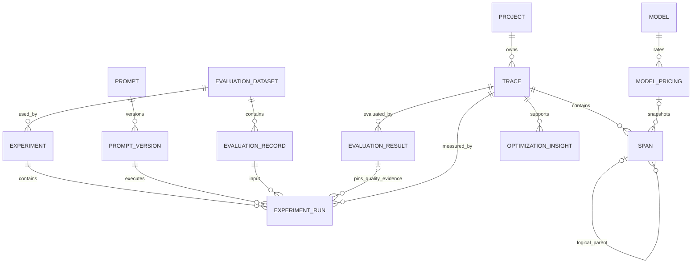
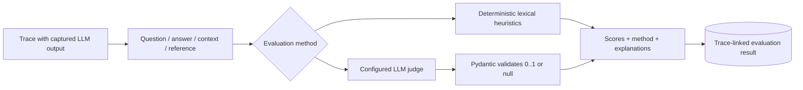
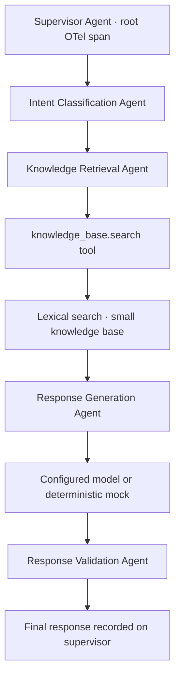

# Architecture and data contracts

## Frontend

React Router renders nine source-scoped screens inside a shared workspace
shell. `hooks/workspace.tsx` owns source, refresh epoch, notifications, and
race-safe data loading. `services/api.ts` centralizes REST and error handling.
Pages own user interactions; reusable panels, tables, charts, and workflow
controls live in `components`. TypeScript contracts are in `types`.

Every metric comes from an API response. Unknown values render as N/A. Changing
the source invalidates all view requests; stale asynchronous results cannot
replace a newer request. The same source is applied to detail and list APIs.
Charts use recent executions or daily aggregates, never decorative fabricated
series. Empty, loading, validation, and connection-error states are explicit.
Tailwind's utility layer is available alongside a shared CSS design system.

## Backend boundaries

- **API:** validation, pagination/filtering, error mapping, OTLP content negotiation.
- **Ingestion:** OTLP IDs, attributes, timestamps, statuses, cost snapshots,
  idempotency, trace assembly. It has no dependency on dashboard rendering.
- **Analytics:** duration, sample-gated percentiles, attribution, coverage and
  scope separation. It does not manufacture usage or prices.
- **Evaluations:** deterministic functions and a configurable HTTP judge,
  validated before storage. Method is part of every evaluation record.
- **Services:** demo orchestration, paired experiments, optimization rules.
- **Database/models:** normalized SQLAlchemy entities and a frozen Alembic
  migration. Startup applies migrations before any queries or seed execution.

FastAPI synchronous handlers execute in its thread pool. The OTLP route reads a
bounded body and invokes the same normalization service. SQLite uses foreign
keys, WAL mode, a 30-second lock timeout, and request-local sessions. Failed
database operations return a safe message and are logged server-side.

## Trace ingestion lifecycle

```mermaid
sequenceDiagram
    participant App as Instrumented application
    participant SDK as OTel SDK
    participant HTTP as OTLP endpoint
    participant N as Normalizer
    participant DB as SQLite
    participant UI as Dashboard
    App->>SDK: Start nested spans; attributes/events/exceptions
    SDK->>HTTP: ExportTraceServiceRequest (protobuf)
    HTTP->>HTTP: Check key, content type, compressed/expanded size
    HTTP->>N: Decode bytes, normalize hex IDs and AnyValue attributes
    N->>DB: Upsert project/trace, insert new spans, snapshot price
    N->>DB: Reassemble trace bounds and status
    HTTP-->>SDK: OTLP success or partialSuccess
    UI->>HTTP: GET trace / analytics (source scope)
    HTTP->>DB: Read captured data
    HTTP-->>UI: Derived metrics and provenance
```

OpenTelemetry protobuf represents IDs as bytes. Generic protobuf JSON renders
those bytes as base64, while OTLP JSON requires hex. `protobuf_payload` performs
that conversion explicitly. The HTTP endpoint accepts OTLP protobuf or OTLP
JSON, handles gzip, rejects invalid envelopes with HTTP 400, and reports
individual invalid spans through standard partial success. Unset optional
usage fields remain null. Protobuf response content type matches the request.

Span identity is `(trace_id, span_id)`. Parent IDs are retained without requiring
arrival ordering. The self-reference is logical rather than an immediate
foreign-key constraint, so a child may arrive before its parent. The viewer
shows orphans as top-level entries and guards against cycles.

## Instrumentation

`opspilot-sdk` creates a dedicated TracerProvider, so it does not replace an
application's global OTel provider. Its context manager sets the operation kind,
records exceptions, records error type/status, and re-raises. Batching is the
default for external apps. `headers` and `remote_context` support W3C propagation.
The in-process demo exporter is synchronous and routes actual encoded spans
through the same normalizer. No gateway intercepts model traffic.

Key attributes:

| Attribute | Meaning |
|---|---|
| `opspilot.project`, `opspilot.source`, `opspilot.mode` | Project and provenance |
| `opspilot.kind` | agent / llm / retrieval / tool / workflow |
| `gen_ai.request.model`, `gen_ai.response.model` | Requested / observed model |
| `gen_ai.usage.input_tokens`, `gen_ai.usage.output_tokens` | Optional captured usage |
| `opspilot.provider_cost_usd` | Actual charge only when reported |
| `gen_ai.input.messages`, `gen_ai.output.messages` | Optional captured messages |
| `opspilot.question`, `opspilot.context`, `opspilot.reference` | Evaluation inputs |
| `opspilot.input`, `opspilot.output` | Tool/agent input and output |
| `opspilot.handoff.failed` | Explicit handoff failure evidence |

## Database relationships



Trace summaries are derived rather than duplicating token/cost aggregates in
the trace table. Indexes cover project/source/status/time, trace/span parents,
model prices, evaluation trace IDs, experiment runs and insight trace IDs.
Prompt/version and trace/rule uniqueness prevent duplicate identities. Captured
attributes and events use JSON because provider payload shapes vary.

## Metrics and pricing

Execution latency is `max(span.end) - min(span.start)` in milliseconds. Individual
operation timing is inclusive; nested durations overlap and are never summed
to claim a critical path. Percentiles use linear interpolation: P50 requires
2 executions, P95 requires 20, and P99 requires 100.

For nested usage reporters, the deepest reporting spans are selected to avoid
counting both wrappers and their child calls. Usage is attributed to the nearest
ancestor agent; captured agent durations remain inclusive. Every query scopes
traces by `demo` or `collected`, and derived queries inherit that scope.

```
estimated_USD = (input_tokens × input_rate_per_million
              + output_tokens × output_rate_per_million) / 1_000_000
```

The latest configured rate is selected at ingestion and its ID and result are
stored on the span. New prices affect new spans; exporter retries cannot alter
historical estimates. Both token counts and a matching rate are needed for a
complete estimate. Provider cost is a different nullable column. No fallback
labels an estimate as a provider charge. Coverage tells the reader how many
usage spans were priced; totals represent only available captured values.

## Evaluation pipeline



Heuristics tokenize non-stopword terms into sets. Answer relevance is question
term coverage; faithfulness is the answer term fraction present in context;
context relevance is question term coverage in context; hallucination indicator
is one minus lexical support; reference correctness is token-set F1. Custom
heuristic criteria use required-term coverage. Empty prerequisites yield null.
These signals cannot establish semantic relevance, factual truth, or definitive
hallucination detection. The mock demo is explicitly labeled.

The judge sends untrusted evaluation data separately from judging instructions,
requires JSON output, validates scores and explanations, and nulls dimensions
without the required context/reference. It is a separate stored method, so
heuristic and judge scores are not silently averaged. A key is required; there
is no mislabeled automatic fallback. RAGAS is not installed or claimed.

## Prompt experiments

Versions store immutable text and retrieval window. Experiments reference one
dataset and two to four versions of the same prompt. Execution interleaves
versions for each record. Each run links its dataset record, version, and trace;
quality scores come from stored evaluations, and usage/latency/cost from spans.

Each run pins the exact `evaluation_id` generated during execution; later
manual reevaluations cannot change a historical comparison. The report exposes
those IDs alongside its traces. A missing pinned evaluation remains unavailable,
even if another evaluation is added later. Migration 0002 links existing runs
to the latest heuristic visible at migration time; it cannot reconstruct earlier
evaluation choices that were never recorded.

Datasets may be created in the UI or through `POST /api/datasets`. They contain
1–25 distinct questions and optional reference answers. Whitespace-only names,
duplicate normalized questions, and oversized fields are rejected. Dataset
content is immutable; revisions use a new dataset so pairing remains reproducible.

Reports require identical complete record sets before labeling the comparison
paired. Missing measurements yield N/A. A failed execution is retained and does
not gain an invented quality score. A paired faithfulness decline greater than
0.05 creates a regression insight. Mock results describe the mock workload,
not production model capability. No minimum improvement is prefilled.

## Optimization rules

| Rule | Evidence required | Recommended direction |
|---|---|---|
| Slow retrieval | >200 ms and >40% of trace elapsed time | Inspect queries/dependencies and unnecessary searches |
| Large input | >1,800 captured input units | Deduplicate and reduce retrieved context |
| Repeated tool | Same tool and captured input ≥3 times in one trace | Review retries, stopping conditions, caching |
| Execution failure | Recorded error / timeout | Inspect exception events and recovery paths |
| Deep chain | Parent chain >12 levels | Review recursion and sequential dependencies |
| Weak support | Stored faithfulness <0.5, with method | Review grounding alongside the context |
| Failed handoff | Explicit `opspilot.handoff.failed=true` | Validate handoff inputs and receiving agent |
| Prompt regression | Complete paired dataset, faithfulness drops >0.05 | Review prompt diff and rerun paired cases |

Every stored insight has title, severity, category, trace, optional agent,
evidence, explanation, action, and review status. A unique trace/rule pair makes
analysis idempotent and preserves human status decisions. No extrapolated
savings percentage is generated. When rules lack evidence, the empty state
explains that data is insufficient.

## Sample workflow



The StateGraph executes classification, retrieval, generation and validation
inside the supervisor's context. A small lexical retriever ranks support policy
documents. Baseline uses five documents and a longer prompt; optimized uses two
and concise instructions. The workflow records captured context and optional
reference answer, enabling post-execution evaluations. Fault scenarios inject a
real 300 ms retrieval delay, an exception, repeated tool calls, duplicate context,
or an intentionally irrelevant answer. No trace timestamp is backdated.

## Deployment scope

Compose runs backend, static frontend/Nginx, and sample service. A persistent
volume stores SQLite. An optional Cloudflare Tunnel profile exposes the frontend
and its API proxy for temporary demonstrations. It is opt-in. The repository
does not imply production readiness or perform deployment automatically.
