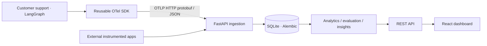

# OpsPilot implementation map

The backend is a modular monolith. Ingestion owns normalization; SQLAlchemy owns
durable records; analytics derives metrics from leaf usage spans; evaluations
store explicit method and provenance; insight rules keep supporting trace IDs.
The React client requests the same source scope for every screen.

## Build phases

1. Scaffold and architecture.
2. Schema and migration.
3. OpenTelemetry SDK and ingestion.
4. Trace APIs and hierarchy.
5. Performance and pricing analytics.
6. LangGraph support workflow.
7. Heuristic and configurable judge evaluations.
8. Prompt versions and paired dataset experiments.
9. Agent analytics and evidence rules.
10. React integration.
11. End-to-end tests, demo bootstrap, documentation.
12. Compose and optional Cloudflare Tunnel.

Detailed architecture and verification notes are in `architecture/README.md`.
